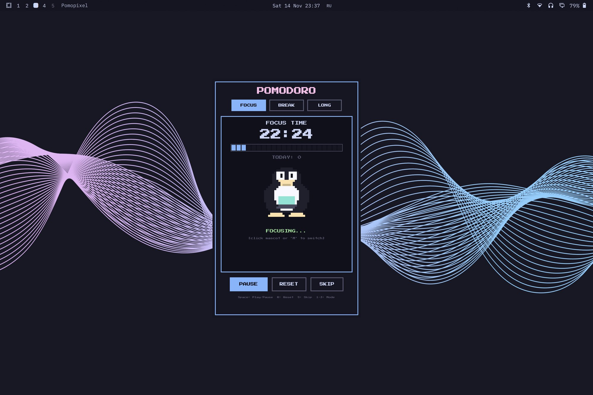

# Pomopixel Bar 🍅

Native retro pixel-art Pomodoro bar widget with ticking timer, 32×32 animated mascots, and popout panel for **Omarchy** (Arch Linux + Hyprland + Quickshell).



## Features

- **Live Status Bar Ticker**: Always see remaining focus time and session status right in your Omarchy status bar.
- **Drop-Down Retro Popout Panel**: Click the bar icon to slide out the full pixel-art dashboard with large timer, segmented progress bar, controls, and animated mascots.
- **32×32 Animated Mascots**:
  - 🥟 **Dumpling Blob**: Bouncing and sleeping blob from the retro aesthetic.
  - 🐧 **Linux Tux**: Tux typing on a pixel laptop while focusing, snoozing on break.
  - 👾 **Claude Critter**: Retro purple pet critter.
  - 👻 **Pac-Man Ghost**: Blinky in action.
- **Omarchy Theme Synchronization**: Synchronizes live with `~/.local/state/omarchy/current/theme/colors.toml`.
- **Keyboard Shortcuts in Panel**:
  - `Space`: Start / Pause
  - `R`: Reset current session
  - `S`: Skip to next session
  - `M`: Cycle mascot
  - `1`: Focus Mode (25m)
  - `2`: Short Break (5m)
  - `3`: Long Break (15m)
  - `Esc`: Close popout panel
- **Quick Bar Controls**:
  - `Left Click`: Toggle Popout Panel
  - `Right Click`: Quick Start / Pause without opening panel
  - `Middle Click`: Quick Reset
- **Smooth Audio & Desktop Notifications**: Synthesized soft chimes for focus start/finish, with native `notify-send` integration.

## Installation & Activation

Symlink or copy this repository to your Omarchy plugins directory:

```bash
mkdir -p ~/.config/omarchy/plugins
ln -s ~/Projects/pomopixel-bar ~/.config/omarchy/plugins/pomopixel-bar
```

Enable the plugin in the bar:

```bash
omarchy plugin enable pomopixel-bar right
```

## Configuration

Settings are saved in `~/.config/pomopixel/config.json`:

```json
{
  "focusDuration": 25,
  "shortBreakDuration": 5,
  "longBreakDuration": 15,
  "longBreakInterval": 4,
  "soundEnabled": true,
  "volume": 1.0,
  "notificationsEnabled": true,
  "mascot": "blob",
  "customAccent": ""
}
```

## License

MIT License.
